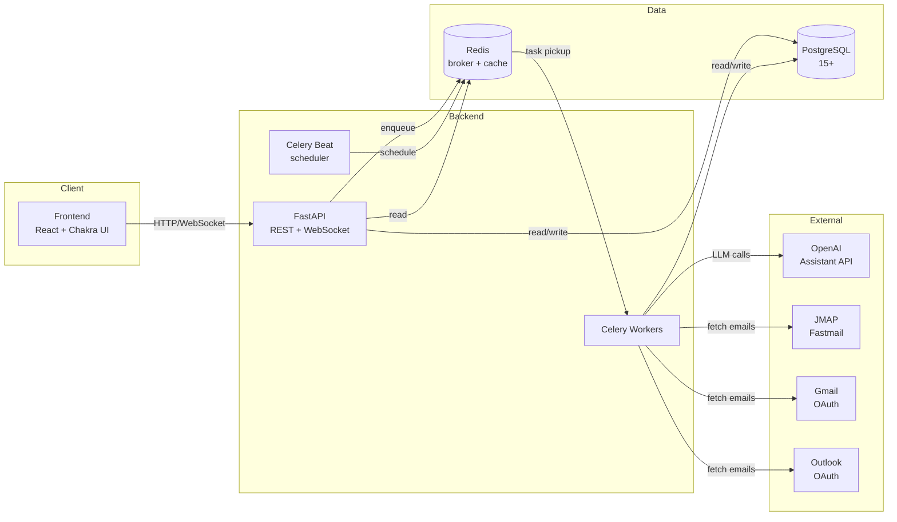

# Architecture Overview

> 30,000-foot view of subscription_tracker. For domain detail, see the
> sibling files in this directory and `graphify-out/GRAPH_REPORT.md` for
> code-level structure.

## Executive Summary

A multi-user SaaS web application that automatically discovers and tracks subscriptions by analyzing emails from connected mailboxes using AI-powered extraction, supporting JMAP (with extensibility for Gmail/Outlook OAuth).

## Tech Stack

**Frontend**
- Framework: React 18+ with TypeScript
- UI Library: Chakra UI
- State Management: React Query + Context API
- Charts: Recharts
- Build Tool: Vite
- HTTP Client: Axios

**Backend**
- Framework: FastAPI (Python 3.11+)
- ORM: SQLAlchemy 2.0
- Validation: Pydantic v2
- Migrations: Alembic
- Task Queue: Celery 5+
- Broker/Cache: Redis 7+
- ASGI Server: Uvicorn

**Database**
- Primary DB: PostgreSQL 15+
- Features Used: JSONB, Full-text search, Triggers

**AI/LLM**
- Provider: OpenAI
- Model: GPT-4o-mini (configurable)
- Integration: OpenAI Assistants API
- Fallback: Direct API calls for simple extraction

**Email Integration**
- Primary: JMAP (Fastmail)
- Architecture: Unified provider interface
- Future: Gmail OAuth, Outlook OAuth, IMAP

**DevOps**
- Containerization: Docker + Docker Compose
- Reverse Proxy: Nginx (optional for production)
- Environment: Separate dev/prod configurations

## High-Level Components

## Data Flow Summary

The end-to-end email-to-subscription flow is detailed in `email-pipeline.md`. Briefly: a user connects a mailbox → a Celery worker fetches emails in batches → each email is classified (template or AI) → relevant emails are extracted → results are deduplicated against existing subscriptions → confidence-routed (auto-accept, manual review, reject) → persisted.

## Domain Documentation

| Concern | Document |
|---|---|
| Database schema and conventions | `data-model.md` |
| Email ingestion and processing pipeline | `email-pipeline.md` |
| OpenAI Assistant configuration and prompts | `ai-strategy.md` |
| Subscription deduplication algorithm | `deduplication.md` |
| JWT auth, password storage, credential encryption | `auth.md` |
| REST API conventions | `api-conventions.md` |
| Application-level security model | `security.md` |

## Technology Choices Rationale

**FastAPI vs Django/Flask:**
- FastAPI: Modern, async, automatic OpenAPI docs, Pydantic validation
- Better for API-first architecture with real-time features

**React Query vs Redux:**
- React Query: Better for server-state management, automatic caching, less boilerplate
- Context API sufficient for minimal client-state (auth, settings)

**Celery vs alternatives:**
- Celery: Mature, robust, good monitoring tools (Flower)
- Redis broker: Fast, simple, works well for our scale

**PostgreSQL vs MongoDB:**
- PostgreSQL: Structured data, ACID compliance, powerful querying
- JSONB for flexible fields (extracted_data, payment_processor)

**Chakra UI vs Material-UI:**
- Chakra: Modern, accessible by default, TypeScript support, easier theming
- Good component library without being opinionated

## Open Questions

1. **Email retention**: How long to keep email processing records?
2. **AI costs**: Budget for OpenAI API usage at scale?
3. **Backup strategy**: Frequency and retention for database backups?
4. **Production hosting**: Cloud provider preference (AWS, GCP, Azure, DigitalOcean)?
5. **Domain name**: What domain for production deployment?

## Code-Level Map

For class/function-level dependency analysis, read `graphify-out/GRAPH_REPORT.md`. The graph is regenerated automatically at session end whenever backend Python files change (Stop hook).
