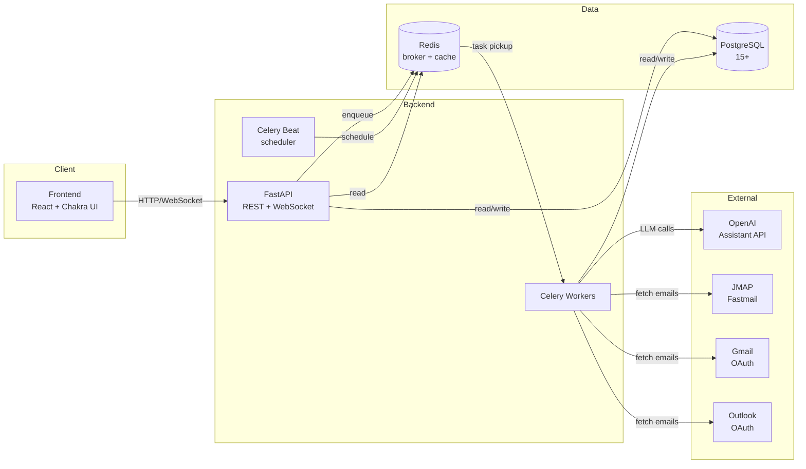

# Doc Refactor & Resource Graph Implementation Plan

> **For agentic workers:** REQUIRED SUB-SKILL: Use superpowers:subagent-driven-development (recommended) or superpowers:executing-plans to implement this plan task-by-task. Steps use checkbox (`- [ ]`) syntax for tracking.

**Goal:** Reorganise 16 .md files (~7,900 lines) into a Claude-optimised `docs/` hierarchy, slim down `CLAUDE.md` from ~400 to ~250 lines, generate a backend code dependency graph via the `graphify` skill, and add 3 high-value slash commands (`/precommit`, `/migrate`, `/restart-and-tail`).

**Architecture:** Sequential phases that each produce a self-contained, committed change. Earlier phases lay down structure (directory tree, simple moves, consolidations, TECHNICAL_SPEC split). Later phases build on the new structure (CLAUDE.md rewrite, slash commands, graphify, Mermaid overview). The final phase fixes any internal references broken by moves.

**Tech Stack:** Markdown, Mermaid, Bash (shell hook), `graphify` skill (Python tree-sitter AST), Git, Claude Code project-scoped slash commands and hooks.

**Source spec:** `docs/superpowers/specs/2026-04-25-doc-refactor-and-graph-design.md`

**Branch:** `chore/doc-refactor-and-graph` (already created from `origin/main`, spec already committed at `795aab5`).

---

## Methodology Note: TDD Adaptation for Doc Work

Strict TDD ("write a failing test first") doesn't fit a documentation refactor. Instead, every task in this plan follows a **verification-driven** pattern:

1. Make the change.
2. Run a verification command (file exists / content matches / link not broken / hook triggers).
3. Commit.

For tasks that produce executable artefacts (slash commands, Stop hook), there are real test steps (run the command/script and observe output). For pure file moves and content rewrites, the verification is structural (path checks, grep for broken refs, line count sanity).

---

## File Structure

### Files to be created

| Path | Source | Purpose |
|---|---|---|
| `docs/index.md` | NEW | Top-level table of contents for `docs/` |
| `docs/setup.md` | from `SETUP.md` | Move only |
| `docs/operations/deployment.md` | merge `DEPLOYMENT.md` + `PRODUCTION_DEPLOYMENT.md` | Consolidation |
| `docs/operations/ci-cd.md` | from `docs/CI-CD-SETUP.md` | Move only |
| `docs/operations/backup.md` | from `BACKUP_GUIDE.md` | Move only |
| `docs/operations/sync.md` | merge `SYNC_GUIDE.md` + `FRONTEND_SYNC_GUIDE.md` | Consolidation |
| `docs/operations/commands.md` | NEW | Reference: ad-hoc commands + scripts/ inventory + suspects audit |
| `docs/architecture/overview.md` | NEW | High-level + Mermaid diagram |
| `docs/architecture/data-model.md` | extracted from `TECHNICAL_SPEC.md` | Split |
| `docs/architecture/email-pipeline.md` | extracted from `TECHNICAL_SPEC.md` | Split |
| `docs/architecture/ai-strategy.md` | extracted from `TECHNICAL_SPEC.md` | Split |
| `docs/architecture/deduplication.md` | extracted from `TECHNICAL_SPEC.md` | Split |
| `docs/architecture/auth.md` | merge `AUTH_GUIDE.md` + auth section of `TECHNICAL_SPEC.md` | Consolidation |
| `docs/architecture/api-conventions.md` | extracted from `TECHNICAL_SPEC.md` | Split |
| `docs/architecture/security.md` | extracted from `TECHNICAL_SPEC.md` | Split |
| `docs/features/push-notifications.md` | from `docs/PUSH_NOTIFICATIONS_BACKEND.md` | Move only |
| `docs/roadmap/current.md` | from `ROADMAP.md` | Filtered (active items only) |
| `docs/roadmap/mobile.md` | from `docs/MOBILE_ROADMAP.md` | Move only |
| `docs/_archive/SESSION_SUMMARY-2025-11-15.md` | from `SESSION_SUMMARY.md` | Archive |
| `docs/_archive/roadmap-phase-1-completed.md` | extracted from `ROADMAP.md` | Archive completed items |
| `.claude/commands/precommit.md` | NEW | Slash command |
| `.claude/commands/migrate.md` | NEW | Slash command |
| `.claude/commands/restart-and-tail.md` | NEW | Slash command |
| `.claude/hooks/graphify-update.sh` | NEW | Stop hook script (kept separate from settings.json for clarity) |

### Files to be modified

| Path | Change |
|---|---|
| `CLAUDE.md` | Full rewrite (~400 → ~250 lines) |
| `.claude/settings.json` | Add Stop hook entry (preserve existing PreToolUse hook) |
| `.gitignore` | Add partial graphify-out exclusions |

### Files to be deleted (via `git rm` after content moved)

`SETUP.md`, `DEPLOYMENT.md`, `PRODUCTION_DEPLOYMENT.md`, `BACKUP_GUIDE.md`, `SYNC_GUIDE.md`, `FRONTEND_SYNC_GUIDE.md`, `AUTH_GUIDE.md`, `TECHNICAL_SPEC.md`, `ROADMAP.md`, `SESSION_SUMMARY.md`, `docs/CI-CD-SETUP.md`, `docs/MOBILE_ROADMAP.md`, `docs/PUSH_NOTIFICATIONS_BACKEND.md`.

### Files to be left untouched

`README.md` (public-facing), `AGENTS.md` (already a symlink to `CLAUDE.md`), all code under `backend/`, `frontend/`, `scripts/` (out of scope per spec §12).

---

## Phase 1 — Directory Structure

### Task 1: Create the `docs/` subdirectory tree

**Files:**
- Create: `docs/operations/`, `docs/architecture/`, `docs/features/`, `docs/roadmap/`, `docs/_archive/`

- [ ] **Step 1: Create the directories**

```bash
mkdir -p docs/operations docs/architecture docs/features docs/roadmap docs/_archive
```

- [ ] **Step 2: Verify all directories exist**

```bash
ls -d docs/operations docs/architecture docs/features docs/roadmap docs/_archive
```

Expected output: each path printed on its own line, no errors.

- [ ] **Step 3: Add `.gitkeep` files so empty directories are committed**

```bash
touch docs/operations/.gitkeep docs/architecture/.gitkeep docs/features/.gitkeep docs/roadmap/.gitkeep docs/_archive/.gitkeep
```

- [ ] **Step 4: Stage and commit**

```bash
git add docs/operations/.gitkeep docs/architecture/.gitkeep docs/features/.gitkeep docs/roadmap/.gitkeep docs/_archive/.gitkeep
git commit -m "$(cat <<'EOF'
chore(docs): create docs/ subdirectory tree

Lays down operations/, architecture/, features/, roadmap/, _archive/
as the target hierarchy for the doc consolidation. Empty for now;
populated in subsequent phases.

Co-Authored-By: Claude Opus 4.7 (1M context) <noreply@anthropic.com>
EOF
)"
```

- [ ] **Step 5: Verify clean tree**

```bash
git status
```

Expected: clean working tree (the unrelated modifications to `.serena/project.yml`, `CLAUDE.md`, `.claude/`, `AGENTS.md` may still appear — leave them, they are handled in later phases).

---

## Phase 2 — Simple File Moves (no content change)

These files only need their location changed. We use `git mv` to preserve git history.

### Task 2: Move `SETUP.md` → `docs/setup.md`

**Files:**
- Modify: rename `SETUP.md` → `docs/setup.md`

- [ ] **Step 1: Move the file with `git mv`**

```bash
git mv SETUP.md docs/setup.md
```

- [ ] **Step 2: Verify the move**

```bash
ls -la SETUP.md 2>&1 | head -1   # should print "No such file"
ls -la docs/setup.md             # should print the file with size
```

- [ ] **Step 3: Commit**

```bash
git commit -m "$(cat <<'EOF'
chore(docs): move SETUP.md to docs/setup.md

Co-Authored-By: Claude Opus 4.7 (1M context) <noreply@anthropic.com>
EOF
)"
```

### Task 3: Move `BACKUP_GUIDE.md` → `docs/operations/backup.md`

**Files:**
- Modify: rename `BACKUP_GUIDE.md` → `docs/operations/backup.md`

- [ ] **Step 1: Move with `git mv`**

```bash
git mv BACKUP_GUIDE.md docs/operations/backup.md
```

- [ ] **Step 2: Verify**

```bash
[ ! -f BACKUP_GUIDE.md ] && [ -f docs/operations/backup.md ] && echo OK
```

Expected output: `OK`.

- [ ] **Step 3: Commit**

```bash
git commit -m "$(cat <<'EOF'
chore(docs): move BACKUP_GUIDE.md to docs/operations/backup.md

Co-Authored-By: Claude Opus 4.7 (1M context) <noreply@anthropic.com>
EOF
)"
```

### Task 4: Move `docs/CI-CD-SETUP.md` → `docs/operations/ci-cd.md`

- [ ] **Step 1: Move**

```bash
git mv docs/CI-CD-SETUP.md docs/operations/ci-cd.md
```

- [ ] **Step 2: Verify**

```bash
[ ! -f docs/CI-CD-SETUP.md ] && [ -f docs/operations/ci-cd.md ] && echo OK
```

- [ ] **Step 3: Commit**

```bash
git commit -m "$(cat <<'EOF'
chore(docs): move docs/CI-CD-SETUP.md to docs/operations/ci-cd.md

Co-Authored-By: Claude Opus 4.7 (1M context) <noreply@anthropic.com>
EOF
)"
```

### Task 5: Move `docs/MOBILE_ROADMAP.md` → `docs/roadmap/mobile.md`

- [ ] **Step 1: Move**

```bash
git mv docs/MOBILE_ROADMAP.md docs/roadmap/mobile.md
```

- [ ] **Step 2: Verify**

```bash
[ ! -f docs/MOBILE_ROADMAP.md ] && [ -f docs/roadmap/mobile.md ] && echo OK
```

- [ ] **Step 3: Commit**

```bash
git commit -m "$(cat <<'EOF'
chore(docs): move docs/MOBILE_ROADMAP.md to docs/roadmap/mobile.md

Co-Authored-By: Claude Opus 4.7 (1M context) <noreply@anthropic.com>
EOF
)"
```

### Task 6: Move `docs/PUSH_NOTIFICATIONS_BACKEND.md` → `docs/features/push-notifications.md`

- [ ] **Step 1: Move**

```bash
git mv docs/PUSH_NOTIFICATIONS_BACKEND.md docs/features/push-notifications.md
```

- [ ] **Step 2: Verify**

```bash
[ ! -f docs/PUSH_NOTIFICATIONS_BACKEND.md ] && [ -f docs/features/push-notifications.md ] && echo OK
```

- [ ] **Step 3: Commit**

```bash
git commit -m "$(cat <<'EOF'
chore(docs): move docs/PUSH_NOTIFICATIONS_BACKEND.md to docs/features/push-notifications.md

Co-Authored-By: Claude Opus 4.7 (1M context) <noreply@anthropic.com>
EOF
)"
```

### Task 7: Archive `SESSION_SUMMARY.md`

- [ ] **Step 1: Move with renamed destination (date-prefix)**

```bash
git mv SESSION_SUMMARY.md docs/_archive/SESSION_SUMMARY-2025-11-15.md
```

- [ ] **Step 2: Verify**

```bash
[ ! -f SESSION_SUMMARY.md ] && [ -f docs/_archive/SESSION_SUMMARY-2025-11-15.md ] && echo OK
```

- [ ] **Step 3: Commit**

```bash
git commit -m "$(cat <<'EOF'
chore(docs): archive SESSION_SUMMARY.md (dated 2025-11-15) to docs/_archive/

Brainstorming session artefact, no longer relevant in the project root.

Co-Authored-By: Claude Opus 4.7 (1M context) <noreply@anthropic.com>
EOF
)"
```

### Task 8: Drop `.gitkeep` files now that subdirs have real content

After tasks 2-7, `docs/operations/`, `docs/features/`, `docs/roadmap/`, `docs/_archive/` all contain at least one real file. `docs/architecture/` is still empty — its `.gitkeep` stays until Phase 3.

- [ ] **Step 1: Remove `.gitkeep` from non-empty subdirs**

```bash
git rm docs/operations/.gitkeep docs/features/.gitkeep docs/roadmap/.gitkeep docs/_archive/.gitkeep
```

- [ ] **Step 2: Verify**

```bash
ls docs/operations/ docs/features/ docs/roadmap/ docs/_archive/
```

Expected: `.gitkeep` is gone from each, real files remain.

- [ ] **Step 3: Commit**

```bash
git commit -m "$(cat <<'EOF'
chore(docs): drop .gitkeep from populated subdirs

Co-Authored-By: Claude Opus 4.7 (1M context) <noreply@anthropic.com>
EOF
)"
```

---

## Phase 3 — Doc Consolidations (merge content)

### Task 9: Consolidate `DEPLOYMENT.md` + `PRODUCTION_DEPLOYMENT.md` → `docs/operations/deployment.md`

The two files cover overlapping but distinct topics: `DEPLOYMENT.md` is the hybrid CI/CD overview, `PRODUCTION_DEPLOYMENT.md` is the Ubuntu+Traefik runbook. Merge into one doc with two clear sections.

**Files:**
- Create: `docs/operations/deployment.md`
- Delete: `DEPLOYMENT.md`, `PRODUCTION_DEPLOYMENT.md`

- [ ] **Step 1: Read both source files in full**

```bash
wc -l DEPLOYMENT.md PRODUCTION_DEPLOYMENT.md
```

Then `Read DEPLOYMENT.md` and `Read PRODUCTION_DEPLOYMENT.md` (whole files).

- [ ] **Step 2: Write `docs/operations/deployment.md`**

The merged structure:

```markdown
# Deployment

> Operational guide for deploying Subscription Tracker. Two contexts:
> hybrid CI/CD workflow (development → production) and the production
> server runbook (Ubuntu + Traefik).

## Quick Start

[Quick-start section from DEPLOYMENT.md, kept verbatim]

## CI/CD Workflow

[Full content of DEPLOYMENT.md minus the quick-start above]

## Production Server Runbook (Ubuntu + Traefik)

[Full content of PRODUCTION_DEPLOYMENT.md, with the duplicated
"Prerequisites" section deduped against DEPLOYMENT.md if there is overlap]
```

Use Read on both source files, Write the merged output. Preserve all code blocks and commands literally — these are operational, copy-paste accuracy matters.

- [ ] **Step 3: Sanity-check the merged file**

```bash
wc -l docs/operations/deployment.md
```

Expected: between 450 and 600 lines (sum of sources is 558; some dedup may reduce). If above 600, re-check for redundant sections; if below 400, content was lost — re-read sources.

- [ ] **Step 4: Verify all top-level headings made it across**

```bash
grep -c '^## ' docs/operations/deployment.md
```

Expected: at least 6 (typically 8-12).

- [ ] **Step 5: Delete the source files**

```bash
git rm DEPLOYMENT.md PRODUCTION_DEPLOYMENT.md
```

- [ ] **Step 6: Stage and commit**

```bash
git add docs/operations/deployment.md
git commit -m "$(cat <<'EOF'
docs(operations): consolidate DEPLOYMENT.md + PRODUCTION_DEPLOYMENT.md

Merged into docs/operations/deployment.md with two sections:
- CI/CD Workflow (from DEPLOYMENT.md)
- Production Server Runbook (from PRODUCTION_DEPLOYMENT.md)

No content lost; redundant prerequisites deduped.

Co-Authored-By: Claude Opus 4.7 (1M context) <noreply@anthropic.com>
EOF
)"
```

### Task 10: Consolidate `SYNC_GUIDE.md` + `FRONTEND_SYNC_GUIDE.md` → `docs/operations/sync.md`

Same pattern as Task 9. `SYNC_GUIDE.md` covers the backend sync logic and CLI, `FRONTEND_SYNC_GUIDE.md` covers the UI flow with progress tracking. Merge as backend section + frontend section.

**Files:**
- Create: `docs/operations/sync.md`
- Delete: `SYNC_GUIDE.md`, `FRONTEND_SYNC_GUIDE.md`

- [ ] **Step 1: Read both source files**

`Read SYNC_GUIDE.md` and `Read FRONTEND_SYNC_GUIDE.md`.

- [ ] **Step 2: Write `docs/operations/sync.md`**

```markdown
# Email Sync

> Complete guide to email sync: backend processing, custom date ranges,
> rate limiting, and the frontend UI with progress tracking.

## Backend Sync

[Content of SYNC_GUIDE.md]

## Frontend Sync UI

[Content of FRONTEND_SYNC_GUIDE.md]
```

- [ ] **Step 3: Verify line count**

```bash
wc -l docs/operations/sync.md
```

Expected: between 480 and 580 lines (sum is 564; minor dedup possible).

- [ ] **Step 4: Delete source files**

```bash
git rm SYNC_GUIDE.md FRONTEND_SYNC_GUIDE.md
```

- [ ] **Step 5: Commit**

```bash
git add docs/operations/sync.md
git commit -m "$(cat <<'EOF'
docs(operations): consolidate SYNC_GUIDE.md + FRONTEND_SYNC_GUIDE.md

Merged into docs/operations/sync.md with two sections (Backend Sync,
Frontend Sync UI). No content lost.

Co-Authored-By: Claude Opus 4.7 (1M context) <noreply@anthropic.com>
EOF
)"
```

### Task 11: Filter `ROADMAP.md` → `docs/roadmap/current.md` + archive completed Phase 1

`ROADMAP.md` (393 lines) mixes active and completed work. Split into two files: `docs/roadmap/current.md` keeps active/upcoming items; `docs/_archive/roadmap-phase-1-completed.md` keeps the historical record.

**Files:**
- Create: `docs/roadmap/current.md`, `docs/_archive/roadmap-phase-1-completed.md`
- Delete: `ROADMAP.md`

- [ ] **Step 1: Read `ROADMAP.md` fully**

`Read ROADMAP.md`.

- [ ] **Step 2: Identify completed sections**

Search for items marked `✅`, `[x]`, `Complete`, `Done`. Block-quote them into a list. These are the candidates for archive.

- [ ] **Step 3: Write `docs/_archive/roadmap-phase-1-completed.md`**

```markdown
# Roadmap — Phase 1 Completed Items (Archive)

> Historical record of items marked complete in ROADMAP.md as of 2026-04-25.
> See docs/roadmap/current.md for active roadmap.

[Move all completed items here, preserving their original structure
and any context paragraphs that explain WHAT was done]
```

- [ ] **Step 4: Write `docs/roadmap/current.md`**

```markdown
# Roadmap — Active

> See docs/_archive/roadmap-phase-1-completed.md for historical/completed items.
> See docs/roadmap/mobile.md for the mobile responsive roadmap.

[All non-completed items from ROADMAP.md, preserving structure]
```

- [ ] **Step 5: Sanity-check both files**

```bash
wc -l docs/roadmap/current.md docs/_archive/roadmap-phase-1-completed.md ROADMAP.md
```

Expected: combined line count of the two new files ≥ original (with section headers added).

- [ ] **Step 6: Delete `ROADMAP.md`**

```bash
git rm ROADMAP.md
```

- [ ] **Step 7: Commit**

```bash
git add docs/roadmap/current.md docs/_archive/roadmap-phase-1-completed.md
git commit -m "$(cat <<'EOF'
docs(roadmap): split ROADMAP.md into active + archived

- docs/roadmap/current.md: active and upcoming items
- docs/_archive/roadmap-phase-1-completed.md: completed Phase 1 items

Original ROADMAP.md removed; nothing lost, just separated by status.

Co-Authored-By: Claude Opus 4.7 (1M context) <noreply@anthropic.com>
EOF
)"
```

---

## Phase 4 — Split TECHNICAL_SPEC.md

`TECHNICAL_SPEC.md` is 2240 lines and is the largest item in this refactor. Split into 7 focused files in `docs/architecture/`. We split section-by-section, with one task per destination file. The auth section is special: it merges with `AUTH_GUIDE.md`.

**Pre-step (do once before Task 12):** Read `TECHNICAL_SPEC.md` in full and produce a section map. The map identifies the line ranges for each destination file. This is a planning artefact only — write it as a comment in your scratchpad, do not commit.

The expected mapping (subject to revision after reading the actual file):

| Destination | Source content (TECHNICAL_SPEC.md) |
|---|---|
| `docs/architecture/data-model.md` | Database schema, tables, JSONB conventions, indexes |
| `docs/architecture/email-pipeline.md` | Email fetch → classify → extract → dedup → save flow |
| `docs/architecture/ai-strategy.md` | OpenAI Assistant config, prompts, confidence routing, two-stage processing |
| `docs/architecture/deduplication.md` | Multi-factor scoring, threshold, PayPal handling |
| `docs/architecture/auth.md` | Auth/JWT/encryption section + full content of `AUTH_GUIDE.md` |
| `docs/architecture/api-conventions.md` | REST patterns, pagination, error responses |
| `docs/architecture/security.md` | Multi-tenancy, encryption, CORS, RLS deferral |

If the actual `TECHNICAL_SPEC.md` structure does not match these themes precisely, adapt destinations — but every section of `TECHNICAL_SPEC.md` must end up in **exactly one** destination file. Track this with a checklist while reading.

### Task 12: Extract data model

**Files:**
- Create: `docs/architecture/data-model.md`

- [ ] **Step 1: Read the data-model section of TECHNICAL_SPEC.md**

Use Read with `offset` and `limit` to read the relevant section.

- [ ] **Step 2: Write `docs/architecture/data-model.md`**

```markdown
# Data Model

> Source of truth for the subscription_tracker database schema.
> Migration files: `backend/alembic/versions/`.

[Extracted content, preserving all schema definitions, table descriptions,
JSONB field conventions, indexing notes]
```

- [ ] **Step 3: Sanity-check**

```bash
wc -l docs/architecture/data-model.md
grep -c '^## ' docs/architecture/data-model.md
```

Expected: at least 50 lines, at least 2 sub-sections.

- [ ] **Step 4: Stage**

```bash
git add docs/architecture/data-model.md
```

(No commit yet — we batch all architecture splits in one commit at Task 18 to keep `TECHNICAL_SPEC.md` deletion atomic.)

### Task 13: Extract email pipeline

- [ ] **Step 1: Read pipeline section**
- [ ] **Step 2: Write `docs/architecture/email-pipeline.md`**

```markdown
# Email Processing Pipeline

> End-to-end flow: mailbox connection → fetch → classify → extract →
> dedup → confidence routing → persistence.

[Extracted content. Include the textual flow diagram from CLAUDE.md
"Email Processing Pipeline" section if it is more recent than the
TECHNICAL_SPEC version]
```

- [ ] **Step 3: Sanity-check**

```bash
wc -l docs/architecture/email-pipeline.md
```

Expected: at least 100 lines.

- [ ] **Step 4: Stage**

```bash
git add docs/architecture/email-pipeline.md
```

### Task 14: Extract AI strategy

- [ ] **Step 1: Read AI section**
- [ ] **Step 2: Write `docs/architecture/ai-strategy.md`**

```markdown
# AI Strategy

> OpenAI Assistant configuration, two-stage processing (classify/extract),
> confidence-based routing, and the learning loop from user corrections.

[Extracted content covering: assistant setup, prompts, models,
confidence thresholds, routing rules, fallbacks]
```

- [ ] **Step 3: Sanity-check**

```bash
wc -l docs/architecture/ai-strategy.md
```

Expected: at least 80 lines.

- [ ] **Step 4: Stage**

```bash
git add docs/architecture/ai-strategy.md
```

### Task 15: Extract deduplication logic

- [ ] **Step 1: Read dedup section**
- [ ] **Step 2: Write `docs/architecture/deduplication.md`**

```markdown
# Subscription Deduplication

> Multi-factor scoring algorithm, scoring weights, threshold rule,
> and the PayPal → actual provider resolution.

[Extracted content. Should cover: scoring weights, threshold logic,
PayPal special-casing, custom_label disambiguation rationale]
```

- [ ] **Step 3: Sanity-check**

```bash
wc -l docs/architecture/deduplication.md
```

Expected: at least 50 lines.

- [ ] **Step 4: Stage**

```bash
git add docs/architecture/deduplication.md
```

### Task 16: Merge auth content (TECHNICAL_SPEC auth section + AUTH_GUIDE.md)

This is the only architecture extraction that also consumes a separate file (`AUTH_GUIDE.md`).

- [ ] **Step 1: Read both sources**

Read the auth section of `TECHNICAL_SPEC.md` and the entirety of `AUTH_GUIDE.md`.

- [ ] **Step 2: Write `docs/architecture/auth.md`**

```markdown
# Authentication & Authorisation

> JWT-based access/refresh flow, bcrypt password storage, Fernet
> credential encryption, multi-tenant isolation via user_id filters.

## Overview

[High-level summary, prefer TECHNICAL_SPEC's version]

## JWT Tokens

[From AUTH_GUIDE.md, preserved verbatim]

## Password Storage

[From AUTH_GUIDE.md or TECHNICAL_SPEC, dedup if both]

## Mailbox Credential Encryption

[From AUTH_GUIDE.md or TECHNICAL_SPEC]

## Multi-Tenancy Model

[From TECHNICAL_SPEC's security section if more detailed]

## Operational Notes

[From AUTH_GUIDE.md: rotating keys, debugging, etc.]
```

Resolve any contradictions between the two sources by preferring the version that matches current code (cross-check `backend/app/security/`).

- [ ] **Step 3: Sanity-check**

```bash
wc -l docs/architecture/auth.md
```

Expected: between 200 and 400 lines (AUTH_GUIDE alone is 478, but we dedup overlap with TECHNICAL_SPEC).

- [ ] **Step 4: Stage and `git rm` AUTH_GUIDE.md**

```bash
git add docs/architecture/auth.md
git rm AUTH_GUIDE.md
```

### Task 17: Extract API conventions and security

Two short sections that get their own files.

- [ ] **Step 1: Read both sections of TECHNICAL_SPEC.md**

- [ ] **Step 2: Write `docs/architecture/api-conventions.md`**

```markdown
# API Conventions

> REST patterns, pagination, error responses, request/response shapes.

[Extracted content: /api/ prefix rule, RESTful naming, error format,
pagination params (page, page_size), schema validation approach]
```

- [ ] **Step 3: Write `docs/architecture/security.md`**

```markdown
# Security

> Application-level security model. (For auth specifics see auth.md.)

[Extracted content: CORS, env-var secrets, application-level filtering
vs PostgreSQL RLS rationale, defense-in-depth deferred to Phase 4]
```

- [ ] **Step 4: Sanity-check both**

```bash
wc -l docs/architecture/api-conventions.md docs/architecture/security.md
```

Expected: each at least 30 lines.

- [ ] **Step 5: Stage**

```bash
git add docs/architecture/api-conventions.md docs/architecture/security.md
```

### Task 18: Verify TECHNICAL_SPEC coverage and delete it

This is the verification gate before deletion. Make sure every section of `TECHNICAL_SPEC.md` ended up in exactly one `docs/architecture/*.md`.

- [ ] **Step 1: List all top-level headings in TECHNICAL_SPEC.md**

```bash
grep -n '^## ' TECHNICAL_SPEC.md
```

Note all section headings.

- [ ] **Step 2: For each heading, confirm it appears in some architecture/*.md**

```bash
for heading in "Data Model" "Email Pipeline" "AI Strategy" "Deduplication" "Authentication" "API" "Security"; do
  echo "=== $heading ==="
  grep -lE "^## .*$heading" docs/architecture/*.md
done
```

Expected: each heading found in exactly one file. (Heading wording may differ — adapt the search terms.)

- [ ] **Step 3: Delete TECHNICAL_SPEC.md**

```bash
git rm TECHNICAL_SPEC.md
```

- [ ] **Step 4: Drop the architecture/.gitkeep**

```bash
git rm docs/architecture/.gitkeep
```

- [ ] **Step 5: Commit the entire architecture split**

```bash
git status   # confirm: 7 new files in docs/architecture/, TECHNICAL_SPEC.md and AUTH_GUIDE.md deleted, .gitkeep gone
git commit -m "$(cat <<'EOF'
docs(architecture): split TECHNICAL_SPEC.md and merge AUTH_GUIDE.md

Replaces the 2240-line monolithic spec with 7 focused docs:

- data-model.md
- email-pipeline.md
- ai-strategy.md
- deduplication.md
- auth.md (also absorbs AUTH_GUIDE.md)
- api-conventions.md
- security.md

Each doc covers one architectural domain. No content lost; verified
that every TECHNICAL_SPEC.md section maps to exactly one destination.

Co-Authored-By: Claude Opus 4.7 (1M context) <noreply@anthropic.com>
EOF
)"
```

---

## Phase 5 — Refactor CLAUDE.md (~400 → ~250 lines)

### Task 19: Rewrite CLAUDE.md as a hub pratique

This task overwrites the entire file. Read the current `CLAUDE.md` first to keep the parts that stay, then write the new version. The current file already has a "graphify" section appended (uncommitted change in working tree) — preserve it.

**Files:**
- Modify: `CLAUDE.md` (full rewrite)

- [ ] **Step 1: Read the current CLAUDE.md**

`Read CLAUDE.md` (the full file).

- [ ] **Step 2: Write the new CLAUDE.md**

Target structure (line counts approximate):

```markdown
# CLAUDE.md

This file provides guidance to Claude Code (claude.ai/code) when working with code in this repository.

## Project Overview

**Subscription Tracker** — A multi-user SaaS web application that automatically discovers and tracks subscriptions by analysing emails from connected mailboxes using AI-powered extraction.

[Keep current Project Overview section verbatim — ~10 lines]

## Tech Stack

[Keep current Tech Stack section verbatim — ~15 lines]

## Git Workflow Rules (MANDATORY)

[Keep current Git Workflow Rules section verbatim — ~20 lines.
These are mandatory and must remain inline.]

## Daily Commands

```bash
# Logs
docker-compose -f docker-compose.dev.yml logs -f backend
docker-compose -f docker-compose.dev.yml logs -f celery_worker

# Restart (triggers hot-reload)
docker-compose -f docker-compose.dev.yml restart backend

# Migrations
docker-compose exec backend alembic revision --autogenerate -m "description"
docker-compose exec backend alembic upgrade head
docker-compose exec backend alembic downgrade -1

# Database access
docker-compose exec postgres psql -U postgres -d subscription_tracker

# Tests
docker-compose exec backend pytest
docker-compose exec frontend npm test

# Install dependencies
docker-compose exec backend pip install <package>  # then update backend/requirements.txt
docker-compose exec frontend npm install <package>
```

For setup, deployment, backups, see `docs/operations/`.
For ad-hoc / less-frequent commands, see `docs/operations/commands.md`.

## Slash Commands

Project-scoped slash commands live in `.claude/commands/`:

- `/precommit` — full pre-commit checklist (lint, format, suggest commit msg)
- `/migrate <description>` — Alembic revision + safety review + upgrade
- `/restart-and-tail <service>` — restart docker service and watch logs 30s

## Architecture Snapshot

Email Processing Pipeline:

```
mailbox → fetch (batch 100) → classify (template/AI) →
extract (template/AI) → dedup (multi-factor score) →
confidence routing (>85% auto / 50-84% review / <50% reject) → save
```

Three critical design decisions (rationale in `docs/architecture/`):

- **OpenAI Assistant over direct API** — context-preserving, structured output, easier to update without code changes. See `docs/architecture/ai-strategy.md`.
- **Celery over simpler alternatives** — retries, monitoring, beat scheduler, horizontal scaling. See `docs/architecture/email-pipeline.md`.
- **Application-level filtering vs PostgreSQL RLS** — simpler now, can add RLS in Phase 4. See `docs/architecture/security.md`.

For everything else architectural, navigate `docs/architecture/`. Reading `graphify-out/GRAPH_REPORT.md` first is recommended for code-level questions.

## Documentation Index

| Need | Doc |
|---|---|
| Set up the project locally | `docs/setup.md` |
| Deploy to production | `docs/operations/deployment.md` |
| CI/CD pipeline | `docs/operations/ci-cd.md` |
| Backup / restore | `docs/operations/backup.md` |
| Email sync (backend & frontend) | `docs/operations/sync.md` |
| Ad-hoc shell commands & scripts/ inventory | `docs/operations/commands.md` |
| Architecture overview + Mermaid diagram | `docs/architecture/overview.md` |
| Database schema | `docs/architecture/data-model.md` |
| Email pipeline detail | `docs/architecture/email-pipeline.md` |
| AI / OpenAI Assistant | `docs/architecture/ai-strategy.md` |
| Subscription deduplication | `docs/architecture/deduplication.md` |
| Auth / JWT / encryption | `docs/architecture/auth.md` |
| REST API conventions | `docs/architecture/api-conventions.md` |
| Security model | `docs/architecture/security.md` |
| Push notifications backend | `docs/features/push-notifications.md` |
| Active roadmap | `docs/roadmap/current.md` |
| Mobile responsive roadmap | `docs/roadmap/mobile.md` |

## Common Gotchas

**Email Processing:**
- JMAP uses provider-specific email IDs — don't assume format.
- HTML emails need BeautifulSoup parsing; French date formats vary, AI handles.
- PayPal emails need special duplicate handling (see `docs/architecture/deduplication.md`).

**Database:**
- Always filter by `user_id` for multi-tenancy.
- Encrypted credentials must be decrypted before use (Fernet, key from env).
- JSONB fields need explicit casting in raw SQL.

**Docker:**
- Volume mounts enable hot-reload.
- DB persists in named volume `postgres_data`.
- Restart backend container after dependency installs.

**Frontend:**
- React Query caches 30s by default.
- WebSocket reconnection logic needed for job progress updates.
- Chakra UI requires ThemeProvider wrapper.

## File Conventions

- Backend tests: `backend/tests/`
- Frontend tests: co-located with components or `frontend/src/__tests__/`
- Utility scripts: `scripts/` (audit in `docs/operations/commands.md`)
- Claude-generated reports/analyses: `claudedocs/`
- Migrations: `backend/alembic/versions/`

## graphify

This project uses graphify for code dependency analysis at `graphify-out/`.

Rules:
- Before answering architecture or codebase questions, read `graphify-out/GRAPH_REPORT.md` for god nodes and community structure.
- If `graphify-out/wiki/index.md` exists, navigate it instead of reading raw files.
- The graph is auto-updated at session end if backend Python files were modified (Stop hook in `.claude/settings.json`).
```

Use Write to overwrite the existing file.

- [ ] **Step 3: Verify line count**

```bash
wc -l CLAUDE.md
```

Expected: between 200 and 280 lines.

- [ ] **Step 4: Verify all doc index links resolve**

```bash
grep -oE 'docs/[^ )]+\.md' CLAUDE.md | sort -u | while read p; do
  [ -f "$p" ] || echo "MISSING: $p"
done
```

Expected: no output (every referenced doc exists).

- [ ] **Step 5: Commit**

```bash
git add CLAUDE.md
git commit -m "$(cat <<'EOF'
docs: refactor CLAUDE.md into a hub (~400 → ~250 lines)

Restructured as: project overview, tech stack, git rules (mandatory,
verbatim), daily commands (top-80%), slash commands pointer, brief
architecture snapshot with pointers, full doc index, top-10 gotchas,
file conventions, graphify pointer.

Removed inline content now in dedicated docs:
- detailed SQL queries (-> docs/operations/commands.md, written in Phase 8)
- detailed auth/security (-> docs/architecture/{auth,security}.md)
- OpenAI Assistant config (-> docs/architecture/ai-strategy.md)
- Phase Roadmap Context (-> docs/roadmap/current.md)
- long troubleshooting list (kept top 10 inline)

Co-Authored-By: Claude Opus 4.7 (1M context) <noreply@anthropic.com>
EOF
)"
```

---

## Phase 6 — Slash Commands

Three project-scoped commands in `.claude/commands/`. They are markdown files with instructions Claude executes when the user types `/<name>`.

### Task 20: Create `/precommit`

**Files:**
- Create: `.claude/commands/precommit.md`

- [ ] **Step 1: Write `.claude/commands/precommit.md`**

```markdown
---
description: Run the full pre-commit checklist (lint, format, suggest commit message)
---

# /precommit

Run the project's mandatory pre-commit workflow defined in CLAUDE.md.

## Steps

1. **Show current state**
   - Run `git status` and `git diff --staged` (or `git diff` if nothing is staged yet) to surface what is about to be committed.
   - If there are no changes, stop here and report "Nothing to commit".

2. **Backend formatter (black)**
   - Run: `docker-compose -f docker-compose.dev.yml exec -T backend python -m black --check app/`
   - If it fails, run `docker-compose -f docker-compose.dev.yml exec -T backend python -m black app/` to auto-fix, then re-run the check.

3. **Backend linter (flake8)**
   - Run: `docker-compose -f docker-compose.dev.yml exec -T backend python -m flake8 app/ --max-line-length=120`
   - Errors block; warnings are tolerated. Surface both clearly.

4. **Frontend linter**
   - Run: `cd frontend && npm run lint`
   - Surface failures; do not auto-fix without asking.

5. **Decide**
   - If all gates pass: read the staged diff, then propose a commit message following the conventional-commits-ish style used in `git log` (look at the last 5 commits via `git log --oneline -5`). Format the suggestion as a HEREDOC the user can copy. Do NOT commit yourself.
   - If any gate fails: list the violations grouped by tool and stop. Do not propose a commit message.

## Notes

- Use `-T` with `docker-compose exec` so it works in non-interactive mode.
- If the backend container is not running, surface a clear error and suggest `docker-compose -f docker-compose.dev.yml up -d`.
- Never `git add` files yourself — the user controls staging.
```

- [ ] **Step 2: Verify the file exists and has frontmatter**

```bash
ls -la .claude/commands/precommit.md
head -3 .claude/commands/precommit.md
```

Expected: file exists, first line is `---`.

- [ ] **Step 3: Commit (do not commit `.claude/commands/migrate.md` or `.claude/commands/restart-and-tail.md` yet — separate tasks)**

```bash
git add .claude/commands/precommit.md
git commit -m "$(cat <<'EOF'
feat(claude): add /precommit slash command

Runs the full pre-commit checklist defined in CLAUDE.md (black, flake8,
frontend lint), auto-fixes black violations, and proposes a commit
message based on the staged diff.

Co-Authored-By: Claude Opus 4.7 (1M context) <noreply@anthropic.com>
EOF
)"
```

### Task 21: Create `/migrate`

**Files:**
- Create: `.claude/commands/migrate.md`

- [ ] **Step 1: Write `.claude/commands/migrate.md`**

```markdown
---
description: Generate and apply an Alembic migration with autogenerate-pitfall review
argument-hint: <description>
---

# /migrate

Generate, review, and apply an Alembic migration. The argument is the migration description used by `alembic revision --autogenerate -m "..."`.

## Steps

1. **Validate input**
   - If no `<description>` argument is provided, ask the user for one and stop.
   - Refuse if it contains shell metacharacters that would break the `-m` flag (`"`, `` ` ``, `$`).

2. **Generate the revision**
   - Run: `docker-compose -f docker-compose.dev.yml exec -T backend alembic revision --autogenerate -m "<description>"`
   - Capture the path of the new migration file from stdout.

3. **Review the generated migration for pitfalls**
   - Read the generated file under `backend/alembic/versions/`.
   - Flag any of:
     - `op.drop_column` or `op.drop_table` (data loss).
     - `op.alter_column` with `nullable=False` and no `server_default` on a column that already has rows.
     - `op.drop_index` without an obvious replacement.
     - Foreign-key drops/recreates without `ondelete=` parity.
     - Renames detected as drop+create (autogenerate cannot infer renames).
   - If anything is flagged, present the concerns and ask the user to confirm before applying.

4. **Apply**
   - Run: `docker-compose -f docker-compose.dev.yml exec -T backend alembic upgrade head`
   - On success, surface the new revision id and `alembic current`.

5. **Rollback offer on failure**
   - If `upgrade head` fails, surface the error and offer: `docker-compose -f docker-compose.dev.yml exec -T backend alembic downgrade -1` (do not run automatically).

## Notes

- Do NOT delete or amend the generated migration file — even if the review flags issues, leave the file in place; the user decides.
- Migrations are committed by the user separately (often via `/precommit`).
```

- [ ] **Step 2: Verify**

```bash
ls -la .claude/commands/migrate.md
grep -c '^##' .claude/commands/migrate.md
```

Expected: file exists; at least 4 sub-sections.

- [ ] **Step 3: Commit**

```bash
git add .claude/commands/migrate.md
git commit -m "$(cat <<'EOF'
feat(claude): add /migrate <description> slash command

Generates an Alembic migration, reviews it for known autogenerate
pitfalls (drops, NOT NULL without default, lost indexes, FK changes),
asks for confirmation if suspect, then applies. Offers rollback hint
on failure.

Co-Authored-By: Claude Opus 4.7 (1M context) <noreply@anthropic.com>
EOF
)"
```

### Task 22: Create `/restart-and-tail`

**Files:**
- Create: `.claude/commands/restart-and-tail.md`

- [ ] **Step 1: Write `.claude/commands/restart-and-tail.md`**

```markdown
---
description: Restart a docker-compose service and tail its logs for 30 seconds
argument-hint: <service> (default: backend)
---

# /restart-and-tail

Restart a docker-compose service and watch its logs for 30 seconds, surfacing errors/warnings.

## Steps

1. **Resolve service**
   - If no `<service>` argument, default to `backend`.
   - Validate the service exists in `docker-compose.dev.yml` (grep `services:` block).

2. **Restart**
   - Run: `docker-compose -f docker-compose.dev.yml restart <service>`
   - On failure, surface the error and stop.

3. **Tail logs for ~30s**
   - Run with timeout: `timeout 30 docker-compose -f docker-compose.dev.yml logs -f --tail=50 <service>` (or use `gtimeout` on macOS without coreutils).
   - On macOS where `timeout` is missing, fall back to: open the logs in background, sleep 30, kill the log process. Provide a one-liner that works.

4. **Report**
   - Filter the captured output for lines matching `(?i)error|warn|exception|traceback`.
   - If matches are found, print them grouped by severity.
   - If no matches, print: `[clean] no errors or warnings detected in 30s`.

## Notes

- Do not interpret routine startup messages (e.g., "Application startup complete") as warnings.
- The 30s window is heuristic; if the service is still starting, the result may be inconclusive — say so.
```

- [ ] **Step 2: Verify**

```bash
ls -la .claude/commands/restart-and-tail.md
```

- [ ] **Step 3: Commit**

```bash
git add .claude/commands/restart-and-tail.md
git commit -m "$(cat <<'EOF'
feat(claude): add /restart-and-tail <service> slash command

Restarts a docker-compose service, tails its logs for ~30s, and surfaces
errors/warnings. Defaults to backend if no service is given.

Co-Authored-By: Claude Opus 4.7 (1M context) <noreply@anthropic.com>
EOF
)"
```

---

## Phase 7 — Graphify + Stop Hook

### Task 23: Configure `.gitignore` for partial graphify-out exclusion

`graphify-out/` will hold both committed markdown (`GRAPH_REPORT.md`, `wiki/`) and ignored binaries (HTML, JSON, PNG).

**Files:**
- Modify: `.gitignore`

- [ ] **Step 1: Append the graphify section to `.gitignore`**

Use Edit to append (do not duplicate if a graphify section already exists).

```
# Graphify (commit GRAPH_REPORT.md + wiki/, ignore binary outputs)
graphify-out/*.html
graphify-out/*.json
graphify-out/*.png
graphify-out/*.svg
graphify-out/*.dot
```

- [ ] **Step 2: Verify**

```bash
grep -A 6 '^# Graphify' .gitignore
```

Expected: the 5-line block above.

- [ ] **Step 3: Commit**

```bash
git add .gitignore
git commit -m "$(cat <<'EOF'
chore: gitignore graphify binary outputs

Keeps GRAPH_REPORT.md and wiki/*.md committed (Claude reads them as
on-demand context); ignores HTML/JSON/PNG/SVG/DOT artefacts.

Co-Authored-By: Claude Opus 4.7 (1M context) <noreply@anthropic.com>
EOF
)"
```

### Task 24: Generate the graphify code dependency graph (backend only)

**Files:**
- Create: `graphify-out/GRAPH_REPORT.md`, `graphify-out/wiki/*.md`, plus ignored binaries.

- [ ] **Step 1: Run graphify on the backend**

Use the `graphify` skill via the Skill tool with the backend path as input. Reference: `~/.claude/skills/graphify/SKILL.md`.

The skill is invoked as: `Skill(skill: "graphify", args: "<args targeting backend/app/>")`. If the skill's interface requires explicit invocation, follow its SKILL.md instructions. The expected output directory is `graphify-out/` at the repo root.

- [ ] **Step 2: Verify output**

```bash
ls graphify-out/
test -f graphify-out/GRAPH_REPORT.md && echo "report OK"
test -d graphify-out/wiki && echo "wiki OK"
```

Expected: `report OK` and `wiki OK`.

- [ ] **Step 3: Spot-check the report**

```bash
head -40 graphify-out/GRAPH_REPORT.md
```

Expected: report has god-node identification, community summaries, and reasonable-looking module names from `backend/app/`.

If the output looks empty or wrong, debug graphify before proceeding (it is a prerequisite for the Stop hook).

- [ ] **Step 4: Commit (only the markdown)**

```bash
git add graphify-out/GRAPH_REPORT.md graphify-out/wiki/
git status   # confirm: HTML/JSON/PNG are NOT staged (gitignore working)
git commit -m "$(cat <<'EOF'
chore: add initial graphify backend dependency graph

Generated via graphify skill on backend/app/. Committed:
- GRAPH_REPORT.md (god nodes, communities, audit)
- wiki/*.md (per-module pages)

Binary outputs (HTML, JSON, PNG, SVG, DOT) are gitignored.

Co-Authored-By: Claude Opus 4.7 (1M context) <noreply@anthropic.com>
EOF
)"
```

### Task 25: Add the Stop hook script

**Files:**
- Create: `.claude/hooks/graphify-update.sh`

- [ ] **Step 1: Create the hooks directory**

```bash
mkdir -p .claude/hooks
```

- [ ] **Step 2: Write the script**

```bash
#!/usr/bin/env bash
# .claude/hooks/graphify-update.sh
# Stop hook: refresh graphify if backend Python files changed this session.
# Best-effort: failure must NOT break session end.

set -uo pipefail   # NB: no `-e` — we tolerate non-fatal errors.

# Detect changes to backend/app/**/*.py since the last commit OR in the working tree.
# We use `git status --porcelain` because the hook runs at session end, possibly
# before the user has committed.
changed=$(git status --porcelain backend/app 2>/dev/null | grep -E '\.py$' || true)

# Also include staged + committed-this-session changes vs origin/main.
upstream_diff=$(git diff --name-only origin/main...HEAD 2>/dev/null | grep -E '^backend/app/.*\.py$' || true)

if [ -z "$changed" ] && [ -z "$upstream_diff" ]; then
    # No backend changes; nothing to update.
    exit 0
fi

# Try the update. Cap output at 20 lines to avoid noise.
if command -v graphify >/dev/null 2>&1; then
    graphify update . 2>&1 | head -20 || \
        echo "[graphify-update.sh] graphify update failed (non-blocking)"
else
    echo "[graphify-update.sh] graphify CLI not in PATH (non-blocking)"
fi

exit 0
```

Use Write to create the file.

- [ ] **Step 3: Make it executable**

```bash
chmod +x .claude/hooks/graphify-update.sh
```

- [ ] **Step 4: Test the script in isolation (no edits scenario)**

```bash
.claude/hooks/graphify-update.sh
echo "exit code: $?"
```

Expected: no output (or graphify-not-in-PATH warning), exit code 0.

- [ ] **Step 5: Test with a fake backend edit**

```bash
touch backend/app/__claude_hook_test.py
git add -N backend/app/__claude_hook_test.py
.claude/hooks/graphify-update.sh
echo "exit code: $?"
rm backend/app/__claude_hook_test.py
```

Expected: either `graphify update` runs successfully, or the script prints a warning. Exit code is 0 in both cases.

- [ ] **Step 6: Commit**

```bash
git add .claude/hooks/graphify-update.sh
git commit -m "$(cat <<'EOF'
chore(claude): add graphify-update Stop hook script

Best-effort refresh of graphify-out/ at session end if any
backend/app/**/*.py was modified during the session. Failures are
logged but never break session termination.

Hook is wired up in .claude/settings.json by the next task.

Co-Authored-By: Claude Opus 4.7 (1M context) <noreply@anthropic.com>
EOF
)"
```

### Task 26: Wire the Stop hook into `.claude/settings.json`

The current `settings.json` already has a `PreToolUse` hook (graphify context-injection on Glob/Grep). Preserve it; add a `Stop` hook alongside.

**Files:**
- Modify: `.claude/settings.json`

- [ ] **Step 1: Read current settings**

`Read .claude/settings.json`. Confirm shape:

```json
{
  "hooks": {
    "PreToolUse": [...]
  }
}
```

- [ ] **Step 2: Write the updated settings**

```json
{
  "hooks": {
    "PreToolUse": [
      {
        "matcher": "Glob|Grep",
        "hooks": [
          {
            "type": "command",
            "command": "[ -f graphify-out/graph.json ] && echo '{\"hookSpecificOutput\":{\"hookEventName\":\"PreToolUse\",\"additionalContext\":\"graphify: Knowledge graph exists. Read graphify-out/GRAPH_REPORT.md for god nodes and community structure before searching raw files.\"}}' || true"
          }
        ]
      }
    ],
    "Stop": [
      {
        "hooks": [
          {
            "type": "command",
            "command": ".claude/hooks/graphify-update.sh"
          }
        ]
      }
    ]
  }
}
```

Use Edit on `.claude/settings.json` (since it exists). The PreToolUse block must remain byte-identical; only add the `Stop` block.

- [ ] **Step 3: Validate JSON**

```bash
python3 -m json.tool .claude/settings.json > /dev/null && echo OK
```

Expected: `OK`.

- [ ] **Step 4: Commit**

```bash
git add .claude/settings.json
git commit -m "$(cat <<'EOF'
chore(claude): wire graphify-update Stop hook in settings.json

Preserves the existing PreToolUse hook that surfaces the graph as
context on Glob/Grep operations.

Co-Authored-By: Claude Opus 4.7 (1M context) <noreply@anthropic.com>
EOF
)"
```

---

## Phase 8 — Architecture Overview with Mermaid

### Task 27: Write `docs/architecture/overview.md`

**Files:**
- Create: `docs/architecture/overview.md`

- [ ] **Step 1: Write the overview**

```markdown
# Architecture Overview

> 30,000-foot view of subscription_tracker. For domain detail, see the
> sibling files in this directory and `graphify-out/GRAPH_REPORT.md` for
> code-level structure.

## High-Level Components



## Data Flow Summary

The end-to-end email-to-subscription flow is detailed in `email-pipeline.md`. Briefly: a user connects a mailbox → a Celery worker fetches emails in batches → each email is classified (template or AI) → relevant emails are extracted → results are deduplicated against existing subscriptions → confidence-routed (auto-accept, manual review, reject) → persisted.

## Domain Documentation

| Concern | Document |
|---|---|
| Database schema and conventions | `data-model.md` |
| Email ingestion and processing pipeline | `email-pipeline.md` |
| OpenAI Assistant configuration and prompts | `ai-strategy.md` |
| Subscription deduplication algorithm | `deduplication.md` |
| JWT auth, password storage, credential encryption | `auth.md` |
| REST API conventions | `api-conventions.md` |
| Application-level security model | `security.md` |

## Code-Level Map

For class/function-level dependency analysis, read `graphify-out/GRAPH_REPORT.md`. The graph is regenerated automatically at session end whenever backend Python files change (Stop hook).
```

- [ ] **Step 2: Verify Mermaid renders (lint)**

There is no built-in Mermaid linter, but a syntactic gate works: confirm the diagram is wrapped in `mermaid` fences and contains no unbalanced brackets.

```bash
awk '/^```mermaid/,/^```$/' docs/architecture/overview.md | wc -l
grep -c '\[' docs/architecture/overview.md   # opening brackets
grep -c '\]' docs/architecture/overview.md   # should match closing
```

Expected: at least 30 lines inside the mermaid block; opening and closing bracket counts equal.

- [ ] **Step 3: Commit**

```bash
git add docs/architecture/overview.md
git commit -m "$(cat <<'EOF'
docs(architecture): add overview with Mermaid component diagram

High-level diagram of frontend, backend (FastAPI + Celery), data
stores (PostgreSQL, Redis), and external services (OpenAI, JMAP,
Gmail, Outlook). Cross-links to domain docs and graphify report.

Co-Authored-By: Claude Opus 4.7 (1M context) <noreply@anthropic.com>
EOF
)"
```

---

## Phase 9 — Operations Index and `scripts/` Audit

### Task 28: Write `docs/operations/commands.md`

This file consolidates the SQL queries that used to live in CLAUDE.md, references the `scripts/` folder, and captures the deduplication-suspects audit.

**Files:**
- Create: `docs/operations/commands.md`

- [ ] **Step 1: Inventory `scripts/` and root-level shell scripts**

```bash
ls scripts/ *.sh 2>/dev/null
```

Note: at the time of writing, the root has `deploy.sh`, `deploy-prod.sh`, `restart.sh`, `update.sh`. `scripts/` has 13 entries. We document what we find now.

- [ ] **Step 2: For each script, capture a one-line purpose**

For each script, run `head -10 <file>` and extract its declared purpose (usually a leading comment). If unclear, mark `[unclear]`.

- [ ] **Step 3: Write `docs/operations/commands.md`**

```markdown
# Commands & Scripts Reference

> Ad-hoc operational commands and an audit of `scripts/`. For day-to-day
> commands, see CLAUDE.md "Daily Commands". For workflows, see
> `.claude/commands/`.

## Useful SQL Queries

```sql
-- Subscriptions pending review
SELECT * FROM email_processing_records
WHERE processing_status = 'pending_review'
  AND user_id = 'user-uuid'
ORDER BY processed_at DESC;

-- User spending summary by category
SELECT category, SUM(amount) AS total, COUNT(*) AS count
FROM subscriptions
WHERE user_id = 'user-uuid' AND is_active = TRUE
GROUP BY category;

-- Failed processing jobs
SELECT * FROM processing_jobs
WHERE status = 'failed'
ORDER BY created_at DESC;
```

## Shell Scripts Inventory (as of 2026-04-25)

### Root-level

| Script | Purpose | Status |
|---|---|---|
| `deploy.sh` | [fill in from header comment] | [active / suspect / unclear] |
| `deploy-prod.sh` | [fill in] | [...] |
| `restart.sh` | [fill in] | [...] |
| `update.sh` | [fill in] | [...] |

### `scripts/`

| Script | Purpose | Status |
|---|---|---|
| `backup.sh` | [fill in] | [...] |
| `backup_postgres.sh` | [fill in] | [...] |
| `create_admin.sh` | [fill in] | [active] |
| `deploy.sh` | [fill in] | [...] |
| `deploy-ci.sh` | [fill in] | [...] |
| `install_sudoers.sh` | [fill in] | [...] |
| `quickstart.sh` | [fill in] | [...] |
| `restore.sh` | [fill in] | [...] |
| `restore_postgres.sh` | [fill in] | [...] |
| `setup.sh` | [fill in] | [...] |
| `setup_auto_backup.sh` | [fill in] | [...] |
| `setup_cron_backup.sh` | [fill in] | [...] |
| `sync_custom_period.sh` | [fill in] | [active] |

## Suspected Duplicates / Cleanup Candidates

The following pairs/triples warrant review (cleanup is OUT OF SCOPE for this refactor — captured here for a future sub-project):

- `scripts/backup.sh` vs `scripts/backup_postgres.sh` — wrapper, or two parallel implementations?
- `scripts/restore.sh` vs `scripts/restore_postgres.sh` — same question.
- `scripts/setup_auto_backup.sh` vs `scripts/setup_cron_backup.sh` — likely overlap.
- Root `deploy.sh` vs `scripts/deploy.sh` vs `scripts/deploy-ci.sh` vs root `deploy-prod.sh` — four deploy entry-points; document which is canonical.
- `scripts/setup.sh` vs `scripts/quickstart.sh` — likely overlap with `docs/setup.md`.

## Ad-Hoc Commands Not Covered Elsewhere

[Empty for now; add as discovered.]
```

Replace each `[fill in...]` placeholder with the actual content extracted in Step 2. Do NOT leave `[fill in...]` placeholders in the committed file.

- [ ] **Step 4: Verify no placeholders remain**

```bash
grep -nE '\[fill in|\[\.\.\.\]|\[active / suspect' docs/operations/commands.md
```

Expected: no output.

- [ ] **Step 5: Commit**

```bash
git add docs/operations/commands.md
git commit -m "$(cat <<'EOF'
docs(operations): add commands.md with SQL queries and scripts inventory

Consolidates the ad-hoc SQL queries previously in CLAUDE.md, inventories
all shell scripts (root + scripts/), and lists suspected duplicates as
candidates for a future cleanup sub-project. Cleanup of scripts/ is
out of scope for this refactor.

Co-Authored-By: Claude Opus 4.7 (1M context) <noreply@anthropic.com>
EOF
)"
```

### Task 29: Write `docs/index.md`

**Files:**
- Create: `docs/index.md`

- [ ] **Step 1: Write the index**

```markdown
# Documentation Index

> Navigation hub for everything under `docs/`. The CLAUDE.md doc index
> mirrors this; if they drift, CLAUDE.md is the source of truth (it's
> auto-loaded into every Claude Code session).

## Setup & Operations

- [Setup](setup.md) — local development setup
- [Deployment](operations/deployment.md) — CI/CD workflow and production runbook
- [CI/CD](operations/ci-cd.md) — pipeline configuration
- [Backup](operations/backup.md) — PostgreSQL backup and restore
- [Sync](operations/sync.md) — email sync (backend & frontend UI)
- [Commands](operations/commands.md) — ad-hoc commands and scripts reference

## Architecture

- [Overview](architecture/overview.md) — high-level component diagram
- [Data Model](architecture/data-model.md)
- [Email Pipeline](architecture/email-pipeline.md)
- [AI Strategy](architecture/ai-strategy.md)
- [Deduplication](architecture/deduplication.md)
- [Auth](architecture/auth.md)
- [API Conventions](architecture/api-conventions.md)
- [Security](architecture/security.md)

## Features

- [Push Notifications](features/push-notifications.md)

## Roadmap

- [Active](roadmap/current.md)
- [Mobile Responsive](roadmap/mobile.md)

## Archive

- [Phase 1 completed items](_archive/roadmap-phase-1-completed.md)
- [Brainstorming session 2025-11-15](_archive/SESSION_SUMMARY-2025-11-15.md)
```

- [ ] **Step 2: Verify all linked files exist**

```bash
grep -oE '\(([^()]+\.md)\)' docs/index.md | tr -d '()' | while read p; do
  full="docs/$p"
  [ -f "$full" ] || echo "MISSING: $full"
done
```

Expected: no output.

- [ ] **Step 3: Commit**

```bash
git add docs/index.md
git commit -m "$(cat <<'EOF'
docs: add docs/index.md as navigation hub

Mirrors the doc index in CLAUDE.md (CLAUDE.md remains source of truth
since it is auto-loaded into every session).

Co-Authored-By: Claude Opus 4.7 (1M context) <noreply@anthropic.com>
EOF
)"
```

---

## Phase 10 — Final Reference Pass

### Task 30: Find and fix broken internal references

After all moves, some internal references in surviving docs may point to old paths (`SETUP.md`, `TECHNICAL_SPEC.md`, etc.).

- [ ] **Step 1: Build a list of old → new path mappings**

```
SETUP.md                      -> docs/setup.md
DEPLOYMENT.md                 -> docs/operations/deployment.md
PRODUCTION_DEPLOYMENT.md      -> docs/operations/deployment.md
BACKUP_GUIDE.md               -> docs/operations/backup.md
SYNC_GUIDE.md                 -> docs/operations/sync.md
FRONTEND_SYNC_GUIDE.md        -> docs/operations/sync.md
AUTH_GUIDE.md                 -> docs/architecture/auth.md
TECHNICAL_SPEC.md             -> docs/architecture/overview.md  (or specific subdoc)
ROADMAP.md                    -> docs/roadmap/current.md
SESSION_SUMMARY.md            -> docs/_archive/SESSION_SUMMARY-2025-11-15.md
docs/CI-CD-SETUP.md           -> docs/operations/ci-cd.md
docs/MOBILE_ROADMAP.md        -> docs/roadmap/mobile.md
docs/PUSH_NOTIFICATIONS_BACKEND.md -> docs/features/push-notifications.md
```

- [ ] **Step 2: Find any surviving references to old paths**

```bash
for old in SETUP.md DEPLOYMENT.md PRODUCTION_DEPLOYMENT.md BACKUP_GUIDE.md \
          SYNC_GUIDE.md FRONTEND_SYNC_GUIDE.md AUTH_GUIDE.md TECHNICAL_SPEC.md \
          ROADMAP.md SESSION_SUMMARY.md CI-CD-SETUP.md MOBILE_ROADMAP.md \
          PUSH_NOTIFICATIONS_BACKEND.md; do
  echo "=== $old ==="
  grep -rn --include='*.md' "$old" . | grep -v 'docs/superpowers/' | grep -v '_archive/' | grep -v '^Binary'
done
```

Expected: each old name returns either nothing or only references inside `docs/superpowers/specs/` and `docs/superpowers/plans/` (those are intentional historical references in this design + plan; do NOT rewrite them).

- [ ] **Step 3: For each match outside the planning docs, rewrite via Edit**

For each finding, use Edit to replace the old path with the new path. Do not use bulk `sed -i` — review each edit case-by-case (some matches may be in code blocks where a literal mention is appropriate).

- [ ] **Step 4: Re-run the search to confirm clean**

Re-run Step 2 and confirm all remaining matches are inside `docs/superpowers/`.

- [ ] **Step 5: Verify all internal `.md` links resolve**

```bash
grep -rno --include='*.md' '\](\([^)]\+\.md\)\)' . | grep -v 'docs/superpowers/' | \
while IFS=: read file lineno match; do
  link=$(echo "$match" | sed 's/.*(\(.*\)).*/\1/')
  base=$(dirname "$file")
  # Resolve relative
  if [[ "$link" == /* ]]; then
    target="$link"
  else
    target=$(cd "$base" && realpath -m "$link" 2>/dev/null)
  fi
  if [ ! -f "$target" ]; then
    # Try as repo-relative
    [ -f "$link" ] || echo "BROKEN: $file:$lineno -> $link"
  fi
done
```

Expected: no `BROKEN:` lines (or only false positives in archive/historical docs you decide to leave).

- [ ] **Step 6: Commit any reference fixes (if there were any)**

```bash
git status   # may show .md files modified
git add -p   # review each hunk before staging
git commit -m "$(cat <<'EOF'
docs: fix internal references after doc consolidation

Updated cross-references in surviving docs to point to new paths
established by the refactor. Historical references inside
docs/superpowers/specs/ and docs/superpowers/plans/ left as-is
(they document the previous structure intentionally).

Co-Authored-By: Claude Opus 4.7 (1M context) <noreply@anthropic.com>
EOF
)"
```

If Step 2 found nothing, skip Steps 3 and 6.

---

## Phase 11 — Final Verification

### Task 31: Smoke-test the full result

A single sweep to confirm the refactor is internally consistent.

- [ ] **Step 1: Confirm no doc files remain at the project root that should have moved**

```bash
ls *.md 2>/dev/null
```

Expected output (only): `AGENTS.md` (symlink), `CLAUDE.md`, `README.md`. Anything else is a leak.

- [ ] **Step 2: Confirm the docs/ tree is clean**

```bash
find docs -type f -name '*.md' | sort
```

Expected: matches the file list in §"Files to be created" of this plan; no unexpected files; no leftover `.gitkeep`.

- [ ] **Step 3: Confirm slash commands and hooks are in place**

```bash
ls .claude/commands/ .claude/hooks/
test -x .claude/hooks/graphify-update.sh && echo "hook executable"
python3 -m json.tool .claude/settings.json > /dev/null && echo "settings.json valid"
```

Expected: 3 command files; 1 hook script (executable); valid JSON.

- [ ] **Step 4: Confirm graphify output exists and is committed**

```bash
git ls-files graphify-out/
```

Expected: `GRAPH_REPORT.md` and several `wiki/*.md` files.

- [ ] **Step 5: Confirm symlink AGENTS.md still resolves**

```bash
readlink AGENTS.md
test -f AGENTS.md && echo "AGENTS.md resolves OK"
```

Expected: `CLAUDE.md`, `AGENTS.md resolves OK`.

- [ ] **Step 6: Run a final lint pass on Markdown if any tool is available**

```bash
command -v markdownlint && markdownlint docs/ CLAUDE.md || echo "markdownlint not installed (skipping)"
```

Non-blocking.

- [ ] **Step 7: Look at the commit history**

```bash
git log --oneline origin/main..HEAD
```

Expected: ~25-30 commits, each with a clear, scoped message. No `WIP` or `fixup` commits.

- [ ] **Step 8: Push the branch**

```bash
git push -u origin chore/doc-refactor-and-graph
```

Expected: branch published. Per CLAUDE.md rules, do **not** open a PR yet — wait for explicit user approval.

- [ ] **Step 9: Surface a one-line summary for the user**

Print a final report to the conversation:

```
✅ Doc refactor + graph complete on branch chore/doc-refactor-and-graph.
   - X commits
   - 16 .md files reorganised into docs/ hierarchy
   - CLAUDE.md slimmed from 401 → ~250 lines
   - 3 slash commands added (.claude/commands/)
   - graphify backend graph generated and committed
   - Stop hook wired up
   - 0 broken internal references
   Ready for PR review.
```

---

## Self-Review (already performed)

- **Spec coverage**: every requirement in the design spec maps to a task or step. The two consolidations (deployment, sync), the seven architecture extractions, the symlink (already in place — no task needed), the archive, the slash commands, the graphify generation, the Stop hook, the Mermaid overview, the scripts audit, and the final reference pass are all explicit tasks.
- **Placeholder scan**: the only intentional placeholders are inside Task 28 (`[fill in from header comment]`) and they are removed before commit (verified in Step 4 of that task).
- **Type / name consistency**: filenames are spelled identically across the file structure section, mapping table, individual tasks, and CLAUDE.md doc index.

## Execution Handoff

Plan complete and saved to `docs/superpowers/plans/2026-04-25-doc-refactor-and-graph.md`. Two execution options:

1. **Subagent-Driven (recommended)** — I dispatch a fresh subagent per task, review between tasks, fast iteration.
2. **Inline Execution** — Execute tasks in this session using `superpowers:executing-plans`, batch execution with checkpoints.

Which approach?
